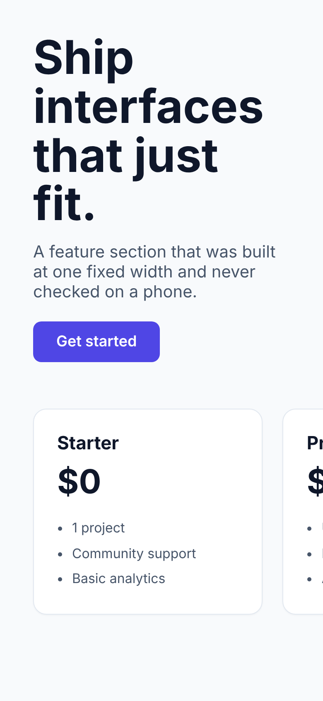
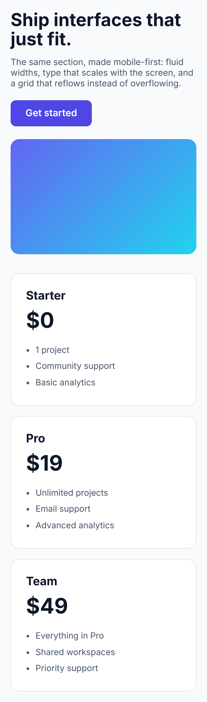
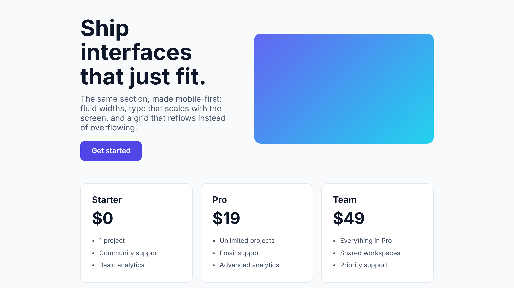

# mobile-responsive

[](https://skills.sh/AsadSumbul/mobile-responsive)
[](./LICENSE)
[](https://www.buymeacoffee.com/AsadSumbul)

An [Agent Skill](https://agentskills.io) that makes your AI coding agent build
web UI that works on every screen, from a 320px phone to a wide desktop, and
then check its own work in a real browser.

| Without the skill | With the skill |
|:------:|:-----:|
|  |  |

The same pricing section at a 390px phone width. The left one was written at a
fixed 960px and never looked at on a phone.

## Install

```bash
npx skills add AsadSumbul/mobile-responsive
```

That installs it into the right folder for your agent. It works with Claude
Code, Cursor, Codex, Copilot, OpenClaw, and any other runtime that supports
[Agent Skills](https://agentskills.io). It is plain markdown plus one script,
so there is no lock-in.

<details>
<summary>Manual install</summary>

```bash
git clone https://github.com/AsadSumbul/mobile-responsive.git ~/.claude/skills/mobile-responsive
```

Use `~/.claude/skills/` to have it in every project, or `.claude/skills/` inside
one project. For other agents, clone into that agent's skills directory, such
as `.agents/skills/` or `.cursor/skills/`.

</details>

## Use

Ask for UI work as you normally would. The skill loads on its own:

> "Build a pricing section."
>
> "Make this page mobile friendly."
>
> "It's overflowing on my phone, fix it."
>
> "Audit the dashboard for responsive problems."

## What the agent does differently

- **Reads your project first.** It picks up your breakpoints, spacing scale,
  tokens, and shared components, and builds with those, so new UI matches what
  is already there. It does not add a second styling system.
- **Writes mobile-first.** The base styles are the phone layout, and wider
  layouts are added on top.
- **Fixes overflow at the element that causes it:** fixed widths, flex children
  that will not shrink, wide images and tables, long strings, `100vw`. It does
  not paper over the problem with `overflow-x: hidden` on `body`.
- **Designs each width**, with columns that reflow, type and spacing that scale,
  44px tap targets, 16px form fields, and nothing that depends on hover.
- **Renders the page and looks at it** at seven widths before saying it is done,
  and tells you how the result was verified.
- **Stays in scope.** Problems it notices in code you did not ask about are
  reported to you and left alone.

It has references for navigation, tables, forms, modals, and images, and for
Tailwind (v3 and v4), plain CSS/SCSS, CSS Modules, styled-components/Emotion,
MUI, Chakra, Mantine, Bootstrap, and Flutter.

## The overflow checker

`scripts/check-overflow.js` loads a URL or an HTML file at each width and names
the element responsible. The agent runs it as part of the workflow, and you can
run it yourself or in CI:

```bash
npm i -D playwright && npx playwright install chromium
```

```bash
node scripts/check-overflow.js http://localhost:3000
```

Its output for the "before" demo page in this repo:

```
FAIL 320px   page scrolls sideways by 640px. Caused by:
     div.wrap "Ship interfaces that just fit.…"  (960px wide, 640px past the edge)

FAIL 768px   page scrolls sideways by 192px. Caused by:
     div.wrap "Ship interfaces that just fit.…"  (960px wide, 192px past the edge)
OK   1024px  no horizontal overflow

FAIL no <meta name="viewport">. Phones will render this page at ~980px and zoom out.
     Add: <meta name="viewport" content="width=device-width, initial-scale=1">
```

It reports:

- horizontal overflow, with the outermost offending elements (content inside a
  scroll container, such as a table in an `overflow-x: auto` wrapper, is
  correctly ignored)
- a missing or wrong viewport meta tag
- content cut off by `overflow-x: hidden` on `body`
- tap targets under 24px and form fields under 16px, as warnings

Options:

| Option | Purpose |
|---|---|
| `--widths 320,767,768` | Widths to test. Default: `320,375,414,768,1024,1280,1440` |
| `--screenshots <dir>` | Save a full-page PNG per width |
| `--height <px>` | Viewport height (default 800), for landscape checks |
| `--wait <ms>` | Extra wait after load for late-rendering apps |

The exit code is 0 when there are no failures, 1 when there are, and 2 when the
page could not be checked.

The checker sees a page as it first loads. It does not log in, open menus, or
fill in data.

## Demo

The responsive version of the demo on a desktop screen:



The demo pages are `assets/before.html` and `assets/after.html`. Regenerate the
screenshots with `node assets/capture.js`.

## Structure

```
mobile-responsive/
├── SKILL.md                         # entry point: the workflow
├── references/
│   ├── components.md                # nav, tables, forms, modals, images
│   ├── overflow-prevention.md       # every overflow cause, fix, and debugging
│   ├── breakpoints.md               # breakpoints, test widths, clamp(), viewport units
│   ├── design-consistency.md        # matching a project's design language
│   └── frameworks.md                # stack-specific syntax
├── scripts/
│   └── check-overflow.js            # render at each width and report problems
├── assets/                          # demo pages and screenshots for this README
├── README.md
└── LICENSE
```

## Contributing

Contributions are welcome. The most useful additions are new framework recipes,
overflow edge cases, and breakpoint refinements.

To contribute:

1. Fork the repo and create a branch for your change.
2. Make the change, and test it against a real layout if it touches behavior.
3. Open a pull request describing what you changed and why.

A few things to keep in mind:

- Keep `SKILL.md` focused and under about 500 lines. Push longer detail into the
  files under `references/`.
- Match the existing tone and structure of the docs.
- For overflow fixes, include the cause as well as the fix so others understand
  the reasoning.

If you are not sure whether something fits, open an issue first and we can talk
it through.

## Support

If this skill saved you some time, you can
[buy me a coffee](https://www.buymeacoffee.com/AsadSumbul).

## License

MIT. See [LICENSE](./LICENSE).
